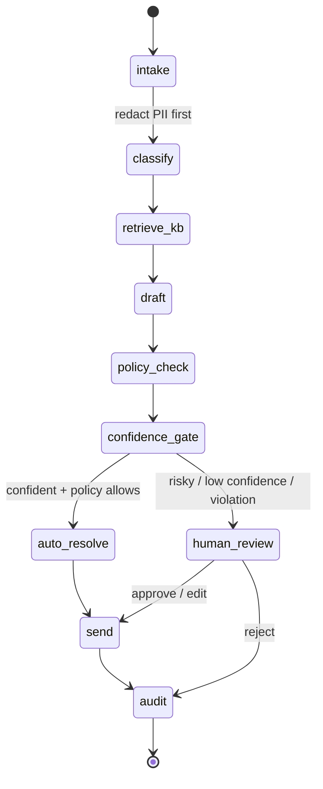

# agent-support-resolution

A production-grade support-resolution agent: classify → retrieve → draft →
policy-as-code check → confidence gate → human approval for anything risky →
send, with every decision in an audit log.

## The problem

Support teams drown in tickets that are 80% answerable from the knowledge
base. The naive fix — "let the LLM auto-reply" — hallucinates policy, leaks
data, and angers customers. One bot promising a $300 refund it was never
allowed to promise costs more than a week of agent salaries.

The production answer is not a smarter prompt. It's a gated pipeline:
the model drafts, but code decides what may be sent. Anything the gate
can't vouch for goes to a human, and everything — every classification,
policy decision, approval, and send — lands in an audit trail.

## How it works



- **intake** — validate the ticket, detect PII in the original text, then
  redact it before anything downstream touches the text.
- **classify** — deterministic rules (no model call): category, intent,
  sentiment, refund amount, third-party-data and PII risk flags.
- **retrieve_kb** — local TF-IDF over a bundled 15-article knowledge base.
- **draft** — mock drafter (default, offline) or Gemini in live mode.
  The drafter proposes; it never decides.
- **policy_check** — policy-as-code. Six named rules: refund cap ($50
  auto-approval limit), third-party PII, raw card/SSN patterns,
  unsupported claims, tone, KB grounding. Hard violations discard the
  draft; soft violations keep it for a human.
- **confidence_gate** — confidence from retrieval quality, policy
  outcome, category risk, and sentiment. Below threshold → human.
- **human_review** — the graph pauses (`interrupt()`), the ticket lands
  in a SQLite review queue, and resumes when a named reviewer approves,
  edits (edited text is re-checked against policy), or rejects.
- **send** — simulated: appends to an outbox log. No real email leaves
  this process.
- **audit** — every node appends to an append-only JSONL audit log as it
  runs: transitions, tool calls, policy decisions, approvers, timestamps.

## Quickstart

```bash
pip install -e ".[dev]"     # mock mode: no API key, no network needed after install
pytest -q                   # 65 tests, all offline
python -m agent_support_resolution.demo
python -m agent_support_resolution.evals
```

The demo runs 10 bundled tickets through the graph — 5 auto-resolve, 5
queue for a human — then works the queue (approve one, edit one, reject
one), prints the audit trail for the large-refund ticket, and runs the
eval set.

Optional live mode (real Gemini drafting; gates identical):

```bash
pip install -e ".[live]"
export GEMINI_API_KEY=...   # GEMINI_MODEL overrides the model (default gemini-3.5-flash-lite)
python -m agent_support_resolution.demo --live
```

## Why LangGraph

The workflow is a state machine with a human-approval interrupt.
LangGraph's checkpointed graph pauses at `interrupt()`, persists state
per ticket thread, and resumes exactly where it stopped when a reviewer
decides — including across process restarts with the SQLite checkpointer
(`SupportPipeline(..., checkpointer="sqlite")`, covered by a test).
Hand-rolling that with callbacks and a status column is how tickets get
lost. The graph also makes the workflow inspectable: the state machine
above is the code, not documentation about the code.

## Production patterns in here

- **Policy-as-code, not policy-in-prompt.** Refund caps, PII rules, and
  claims checks are named, versioned, unit-tested functions. The system
  prompt holds behavior only.
- **The drafter never decides.** Mock or LLM, every draft faces the same
  policy check and confidence gate. Swap the model, keep the gates.
- **Hard vs soft violations.** A draft leaking another customer's email
  is discarded, not "reviewed" — a human writes from scratch. A draft
  promising a $330 refund is kept, because a human can legitimately
  approve it.
- **Redact at the border.** PII is detected on the original ticket (the
  flag survives), then masked before the drafter, audit log, or outbox
  ever see the text.
- **Edited text is re-checked.** Human edits go back through the policy
  rules; a hard violation keeps the ticket in review.
- **Audit everything.** Append-only JSONL, lock-guarded. "Why did the
  bot send that?" has a one-command answer.
- **Evals as a gate.** 12 labeled cases check routing accuracy,
  auto-resolve safety (final text re-passes policy), audit completeness,
  and redaction. `python -m agent_support_resolution.evals` exits
  non-zero on any failure.
- **Thread-safe storage.** SQLite review queue with
  `check_same_thread=False` + lock; audit/outbox appends are locked.

## What's real vs mocked

| Piece | Mock mode (default) | Live mode |
|---|---|---|
| Workflow | real LangGraph graph, checkpointed, interrupt/resume | same |
| Classification, retrieval, policy, confidence | real deterministic code | same |
| Drafting | template composed from the top KB article (deliberately naive about refund amounts, so the gate has something to catch) | real Gemini (`gemini-3.5-flash-lite`) via langchain-google-genai |
| Knowledge base | 15 bundled synthetic articles, TF-IDF | same (swap for a vector store in production) |
| Sending | simulated outbox log — stated plainly | same |
| Tickets | 10 bundled synthetic tickets | same |

## Limitations

- Classification and policy checks are keyword/pattern-based: a draft
  that promises a refund in novel wording ("we'll make you whole for
  three hundred bucks") can slip past the refund rule. Production would
  layer an LLM judge or structured extraction behind the same interface.
- TF-IDF retrieval is lexical; semantic search would rank better on
  paraphrased questions.
- Confidence weights are hand-tuned constants, not learned from labeled
  outcomes.
- The review queue is a local SQLite file and the "send" is a log line —
  both are deliberate seams for real integrations (helpdesk API, ESP).
- Live mode is wired and construction-tested, but the parent verification
  run exercises it against the real Gemini API separately.
